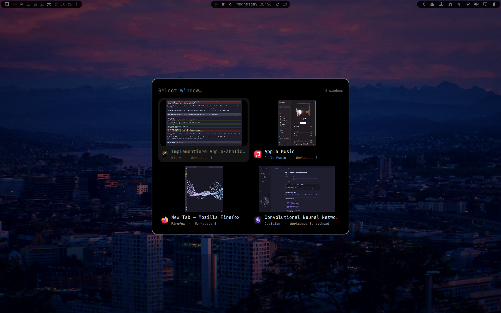

# Windows-style Alt-Tab for Omarchy

A fast, theme-aware overview of every open window, inspired by the familiar
Windows Alt-Tab switcher and built directly for the Omarchy Quattro shell.



## Features

- Shows windows from all regular workspaces in a responsive grid.
- Selects the next window on the first `Alt+Tab` press.
- Cycles while Alt is held and activates on Alt release.
- Supports arrow keys, `Shift+Tab`, Enter, Space, Escape, and the mouse.
- Uses Omarchy's current popup and menu colors automatically.
- Resolves icons through the desktop entry database and local web-app icons
  without making network requests; GitHub reuses the icon from the Apps menu.
- Codex CLI windows (`org.openai.codex`) use the `kitty` name and icon while
  retaining their dedicated app ID for launch/focus shortcuts.

## Requirements

- Omarchy 4 (Quattro) or newer
- `omarchy-shell` running on Hyprland

## Install

```sh
omarchy plugin add https://github.com/leandro-3rne/window-switcher-for-omarchy.git --enable
```

Add the following to `~/.config/hypr/bindings.lua`:

```lua
-- Replace Omarchy's default Alt-Tab bindings with the overview.
hl.unbind("ALT + TAB")
hl.unbind("ALT + SHIFT + TAB")

o.bind(
    "ALT + TAB",
    "Window overview",
    "omarchy-shell shell call io.github.leandro-3rne.window-switcher cycle next"
)

o.bind(
    "ALT + SHIFT + TAB",
    "Window overview (previous)",
    "omarchy-shell shell call io.github.leandro-3rne.window-switcher cycle previous"
)
```

Optionally reuse the same surface as a short empty-scratchpad message:

```lua
hl.unbind("SUPER + S")
o.bind("SUPER + S", "Toggle scratchpad", function()
    for _, window in pairs(hl.get_windows()) do
        if window.workspace and window.workspace.name == "special:scratchpad" then
            hl.dispatch(hl.dsp.workspace.toggle_special("scratchpad"))
            return
        end
    end
    hl.dispatch(hl.dsp.exec_cmd(
        "omarchy-shell shell call io.github.leandro-3rne.window-switcher showScratchpadEmpty '{}'"
    ))
end)
```

Hyprland reloads the file automatically. Check the result with:

```sh
hyprctl configerrors
```

## Usage

- Hold Alt and tap Tab to move forward.
- Hold Alt and press Shift+Tab to move backward.
- Release Alt, or press Enter/Space, to activate the selected window.
- With no windows open, release Alt, press Escape, or repeat either overview
  shortcut to close the empty state.
- Use the arrow keys or mouse when the overview is open.
- The user `Super+Shift+Arrow` binding swaps with a visible neighbour on the
  same monitor first. A swap involving fullscreen exits fullscreen on both
  windows; when no local neighbour exists, it can swap across monitors.
- `Super+Shift+Ctrl+Arrow` moves only the active window to the nearest monitor
  in that direction, even when either monitor has other windows open.
- `Super+Shift+Ctrl+number` moves every window on the active workspace into the
  numbered workspace and follows the destination. If the target is empty, the
  workspace itself moves so its tiled layout is preserved; occupied targets
  receive the moved windows.
- Moving a window into a workspace that has a fullscreen window clears that
  fullscreen state first; this also applies when showing Apple Music.
- Press Escape or click the dimmed background to cancel.
- The empty-scratchpad message closes on Escape, another `Super+S`, a
  background click, or a workspace switch. It stays active while another menu
  such as the app launcher is open, so a window launched there moves into and
  reveals the scratchpad. There is no automatic timeout.
- If the empty-scratchpad message is followed by Alt-Tab, selecting Apple Music
  places it into that scratchpad instead of the workspace behind it. Selecting
  any other-workspace window closes the visible scratchpad before switching.
- Chromium web-app titles omit a trailing `- Web App` label.

You can also summon it directly:

```sh
omarchy-shell shell summon io.github.leandro-3rne.window-switcher '{}'
```

## Web-app icons and network safety

Chromium web apps do not always expose a desktop icon that matches their
window class. Known apps use bundled local icons or installed icon-theme
entries; GitHub deliberately reuses the icon from its Apps-menu launcher, and
unknown apps fall back to their desktop entry icon.

The switcher never derives a URL from a client's app ID and never performs
network requests. This keeps forged Wayland client metadata from turning the
long-running shell into an HTTP client.

## Remove

Remove the two custom bindings from `~/.config/hypr/bindings.lua`, restore any
Alt-Tab bindings you want to keep, then run:

```sh
omarchy plugin remove io.github.leandro-3rne.window-switcher
```

The plugin does not install services, write caches, or modify Hyprland on its
own.

## License

MIT — see [LICENSE](LICENSE).
